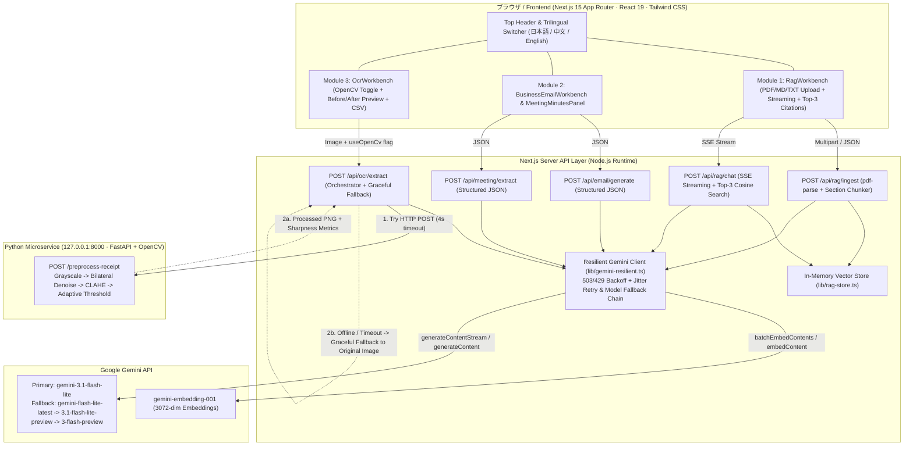

# DocuFlow AI — 企業ナレッジベース＆業務自動化アシスタント

[](https://nextjs.org/)
[](https://www.typescriptlang.org/)
[](https://tailwindcss.com/)
[](https://fastapi.tiangolo.com/)
[](https://ai.google.dev/)

> **DocuFlow AI** は、日本企業のバックオフィスおよび開発現場における「情報検索・社内コミュニケーション・経理データ入力」のボトルネックを解消するために設計・実装した、**Next.js (App Router) + Python FastAPI (OpenCV) + Google Gemini API** 構成の B2B AI ワークベンチです。

---

## 🌐 言語別ナビゲーション / Language Navigation

| 言語 | セクションリンク | コア概要（Executive Summary） |
| :--- | :--- | :--- |
| **日本語（メイン）** | [プロジェクト概要](#-プロジェクト概要) ・ [アーキテクチャ](#-システムアーキテクチャ図) ・ [技術的な工夫](#-技術的な工夫課題解決) ・ [起動手順](#-ローカル環境構築起動手順) | 日系企業向けの社内規定 RAG 検索（出典・類似度表示）、敬語メール＆議事録 ToDo 自動抽出、OpenCV 前処理付き領収書・名刺 OCR（CSV 出力）を統合した業務効率化 AI プラットフォーム。 |
| **中文摘要** | [项目简介（中文）](#-中文核心摘要) ・ [系统架构图](#-システムアーキテクチャ図) ・ [本地启动](#-ローカル環境構築起動手順) | 面向日企办公场景的企业级 AI 工作台：整合「内部规定 RAG 溯源问答」「商务敬语邮件与会议纪要 ToDo 提取」「FastAPI + OpenCV 图像增强 + Gemini 多模态 OCR 导出 CSV」三大模块，内置 503/429 指数退避重试与多模型降级机制，支持日/中/英三语即时切换。 |
| **English Summary** | [English Overview](#-english-executive-summary) ・ [Architecture](#-システムアーキテクチャ図) ・ [Local Setup](#-ローカル環境構築起動手順) | An enterprise B2B AI workbench built with Next.js 15, TypeScript, Tailwind CSS, Python FastAPI (OpenCV), and Gemini API—featuring cited RAG Q&A, Japanese Keigo email & meeting minutes extraction, multimodal receipt/business card OCR with graceful microservice fallback, and real-time JA/ZH/EN UI switching. |

---

## 📌 プロジェクト概要

**DocuFlow AI** は、単なるチャットラッパーではなく、**「検索精度の可視化（RAG 引用トレーサビリティ）」「構造化出力（Structured JSON）」「外部推論 API の高可用性（Resilience）」「画像前処理マイクロサービスとの疎結合連携」** を意識して設計されたフルスタック AI アプリケーションです。

### 解決するビジネス課題（日系企業の実務ペインポイント）

| 課題領域 | 従来の業務ペイン | DocuFlow AI による解決アプローチ |
| :--- | :--- | :--- |
| **1. 社内規定・マニュアル検索の非効率** | 交通費上限・残業申請・テレワーク規定などが PDF や Markdown に散在し、担当部署への問い合わせコストが高い。 | **モジュール1（RAG Q&A）**：文書をセクション単位でチャンク分割・ベクトル化し、コサイン類似度で Top-3 根拠箇所を抽出。回答とともに出典ファイル名・段落番号・類似度スコアを提示。 |
| **2. 敬語メール作成・議事録整理の負担** | 社外顧客・社内上司・同僚の区分に応じた敬語調整や、会議メモからの ToDo・担当者・期限の整理に多くの工数がかかる。 | **モジュール2（敬語メール＆議事録 Agent）**：相手区分別の標準5段構成メールを自動作成。さらに議事録からサマリー・決定事項・ToDo 表を JSON 抽出し Markdown で一括コピー可能。 |
| **3. 紙レシート・名刺の手入力の煩雑さ** | 経費精算の領収書や取引先名刺の項目転記が手作業でミスが起きやすく、暗所撮影や影で OCR 精度が落ちやすい。 | **モジュール3（OpenCV + OCR 抽出）**：Python FastAPI マイクロサービスでグレースケール化・ノイズ除去・CLAHE・適応二値化を実行し、Gemini Vision で構造化 JSON 抽出＆BOM付き CSV 出力。 |

---

## 🏗 システムアーキテクチャ図



---

## 🧩 主な機能モジュール

### モジュール1：企業内部ナレッジベース RAG 質問応答（`RagWorkbench`）
- **多様なドキュメント形式に対応**：`.txt`、`.md`、`.pdf`（`pdf-parse` によるサーバーサイドテキスト抽出）のドラッグ＆ドロップアップロードに対応。
- **ワンクリック体験用サンプル**：アップロード不要で『株式会社サンプル 社内規定・経費精算マニュアル』（交通費上限・残業事前申請・テレワーク規定など）を即座にインデックス化し、3つの推薦質問から検証可能。
- **SSE ストリーミング＆引用ソース可視化**：回答をリアルタイムでストリーミング表示し、各回答バブル下部の折りたたみ可能な **「参照ソース（Citations）」パネル** に、マッチした Top-3 チャンクの **出典ファイル名・チャンク番号（`Chunk #N`）・コサイン類似度プログレスバー・質問キーワードハイライト付き原文** を表示。

### モジュール2：ビジネス敬語メール作成 ＆ 議事録・ToDo自動抽出 Agent
2つのサブタブで「発信」と「整理」の業務を一気通貫で支援します。
- **Tab 1 — ビジネスメール作成（`BusinessEmailWorkbench`）**：
  - 相手区分（`社外顧客` / `社内上司` / `同僚`）に応じた敬語レベル（尊敬語・謙譲語・社内報連相トーン）を自動調整。
  - 電車遅延のお詫びや商談後フォローなど4つのワンクリック定型シーンを搭載し、「件名・宛名・挨拶・正文・結び」＋敬語解説を構造化生成してワンクリックコピー可能。
- **Tab 2 — 議事録・ToDo自動抽出（`MeetingMinutesPanel`）**：
  - 日本語／中国語の会議メモから **「会議サマリー（3項目以内）」「決定事項」「アクションアイテム / ToDo テーブル（タスク内容・担当者・期限・優先度）」** を厳密な JSON で抽出。
  - `プロジェクト定例会議`・`クライアント要件確認MTG` の2種類のサンプルを備え、Slack / Teams / Notion にそのまま貼れる **「Markdown 形式でコピー」** に対応。

### モジュール3：領収書・名刺 OCR インテリジェント抽出（`OcrWorkbench`）
- **Python OpenCV 前処理連携（オン/オフ切替可能）**：レシート・名刺画像を FastAPI マイクロサービスへ送り、画質指標（解像度・処理前後鮮明度スコア）と処理後画像を取得して比較プレビュー表示。
- **ゼロ準備デモモード**：手元に画像がなくても HTML5 Canvas で日系レシート・ビジネス名刺画像をリアルタイム生成し、そのままマルチモーダル OCR パイプラインで抽出テストが可能。
- **Structured JSON ＆ Excel 対応 CSV 出力**：財務領収書（日付・店舗名・合計・消費税・支払方法・摘要・明細行）および名刺（氏名・フリガナ・会社名・部署・役職・電話・メール・住所）をテーブル描画し、文字化け防止の UTF-8 BOM 付き CSV としてダウンロード可能。

### 全サイト共通 UX：日/中/英 3言語切替 ＆ 混在タイポグラフィ統一
- **軽量 i18n 基盤**：外部の重いルーティングライブラリを使わず、型安全なローカル辞書（`lib/i18n.ts`）と React Context（`components/I18nProvider.tsx`）で、ナビゲーション・ステータス・表ヘッダー・引用パネルまでリロードなし・即時切替を実現。
- **日英中混在フォント設計**：`next/font/google` で `Inter`（英数字）、`Noto_Sans_JP`（日本語）、`Noto_Sans_SC`（簡体字中国語）、`JetBrains_Mono`（等幅）を読み込み、言語設定（`html[lang]`）に応じて CJK フォントの優先順位を動的切替することで、混在テキストの字重・ベースラインの違和感を解消。

---

## 🛠 技術的な工夫・課題解決

### 1. API 高負荷（503 / 429）に対する指数バックオフ再試行 ＆ 自動モデル降級
- 実際の開発・テスト中に、特定モデル（例：`gemini-3.1-flash-lite`）が一時的な需要急増により `503 Service Unavailable` を返す事象、および新規 API キーで旧モデルが `404` / Free Tier 枠 `limit: 0` で `429` を返す事象に直面しました。
- これを解決するため、`lib/gemini-resilient.ts` に共通レジリエンス層を構築しました：
  - **指数バックオフ＋ランダムジッター再試行**：`503` / `429` 一過性エラーに対して最大 **3回**（`600ms * 2^(n-1) + jitter(0..400ms)`）リトライし、クライアント切断時は `AbortSignal` で即座に中断。なお、`limit: 0` の恒久的クォータ制限時はリトライを待たず即座に次モデルへスキップ。
  - **ストリーミング首塊（First Chunk）プローブ**：`generateContentStream` 呼び出し直後だけでなく **最初のチャンク受信まで** をリトライ／フォールバック境界に含めることで、接続確立時の `503` でもクライアントへ壊れた途中結果を流さず、代替モデル（`gemini-flash-lite-latest` → `gemini-3.1-flash-lite-preview` → `gemini-3-flash-preview`）へ透過的に切り替えます。
  - **可観測性（Observability）**：サーバーログおよび SSE `meta` / `done` イベント・UI バッジに「実際に使用したモデル名」と「フォールバック発生有無」を明示します。

### 2. セクション認識型チャンキング ＆ インメモリ RAG 引用トレーサビリティ
- 外部ベクトル DB を立てず軽量に完結させるため、`lib/rag-store.ts` で Markdown 見出し・日系規定見出し（`【...】`、`第X章`）を認識してオーバーラップ付きチャンクを生成し、`gemini-embedding-001`（`batchEmbedContents`＋フォールバック個別埋め込み）で 3072 次元ベクトルを算出。
- 検索時はメモリ上でコサイン類似度を計算して Top-3 を抽出し、チャンク番号（`Chunk #N`）・類似度（%）・キーワードハイライト付き原文を返却することでハルシネーションを抑制しつつ検証可能性を確保しています。
- また、Windows Node.js `18.18.0` 環境で `formData.get("file") instanceof File` が `ReferenceError: File is not defined` となる互換性問題や、`pdf-parse` の初期化トラブルに対し、`arrayBuffer` ダックタイピング検証および `next.config.ts` の `serverExternalPackages: ["pdf-parse"]` + `pdf-parse/lib/pdf-parse.js` 直接参照によって安定動作を実現しました。

### 3. Structured Outputs 強制 ＆ Python OpenCV マイクロサービスのグレースフル・デグラデーション
- メール作成・議事録抽出・OCR の各 API では `generationConfig: { responseMimeType: "application/json" }` と防御的パース（`parseGeminiJson`）を組み合わせ、UI テーブルや CSV エクスポートのパースエラーを排除しています。
- OCR における Python FastAPI（OpenCV）連携では、4秒のタイムアウト付きリクエストを送信し、**ローカルの Python サービスが未起動（Vercel などのサーバーレス単体デプロイ時を含む）やタイムアウト時は自動的に原図直連モードへフォールバック**し、UI 上にも状態を明示する疎結合設計としています。

---

## 💻 使用技術スタック

| レイヤー | 技術・ライブラリ | 用途 |
| :--- | :--- | :--- |
| **Frontend** | Next.js 15.1.7 (App Router), React 19, TypeScript 5, Tailwind CSS 3.4, Lucide React | B2B ワークベンチ UI、SSE 受信、3言語 i18n、Canvas サンプル生成・CSV 出力 |
| **Backend (BFF)** | Next.js Route Handlers (`nodejs` runtime), `pdf-parse` 1.1.1 | PDF/テキスト解析、チャンキング、コサイン類似度検索、Gemini 呼び出し制御 |
| **Image Microservice** | Python 3.12, FastAPI, Uvicorn, `opencv-python-headless`, NumPy | 画像前処理（グレースケール・バイラテラルフィルタ・CLAHE・適応二値化）＆画質計測 |
| **AI Models** | `@google/generative-ai` (`gemini-3.1-flash-lite`, `gemini-embedding-001`, 他フォールバック群) | ベクトル埋め込み、RAG ストリーミング回答、構造化 JSON 生成、マルチモーダル OCR |

---

## 📂 ディレクトリ構成

```text
docuflow-ai/
├── app/
│   ├── api/
│   │   ├── email/generate/route.ts    # モジュール2 (Tab 1): 敬語メール生成 API
│   │   ├── meeting/extract/route.ts   # モジュール2 (Tab 2): 議事録・ToDo JSON抽出 API
│   │   ├── ocr/extract/route.ts       # モジュール3: OpenCV連携(フォールバック付) + OCR API
│   │   ├── rag/
│   │   │   ├── chat/route.ts          # モジュール1: Top-3 検索 + SSE ストリーミング API
│   │   │   └── ingest/route.ts        # モジュール1: PDF/MD/TXT 解析 & ベクトル登録 API
│   │   └── test-gemini/route.ts       # Gemini 接続・フォールバック動作確認用エンドポイント
│   ├── globals.css                    # 混在フォント優先制御 & タイポグラフィ基盤
│   ├── layout.tsx                     # next/font/google 設定 & I18nProvider 適用
│   └── page.tsx                       # ワークベンチ全体レイアウト・サイドバー切替
├── components/
│   ├── BusinessEmailWorkbench.tsx     # モジュール2 UI (サブタブ切替 + 敬語メール作成)
│   ├── I18nProvider.tsx               # 3言語切替 Context & localStorage 永続化
│   ├── LanguageSwitcher.tsx           # ヘッダー右上 日本語/中文/English 切替 UI
│   ├── MeetingMinutesPanel.tsx        # モジュール2 (Tab 2) 議事録・ToDo表 & Markdownコピー
│   ├── OcrWorkbench.tsx               # モジュール3 UI (OpenCVトグル・比較プレビュー・CSV)
│   └── RagWorkbench.tsx               # モジュール1 UI (アップロード・Top-3 引用パネル)
├── lib/
│   ├── gemini-resilient.ts            # 503/429 指数バックオフ再試行 & 自動降級共通基盤
│   ├── i18n.ts                        # ja / zh / en 型安全辞書
│   ├── rag-store.ts                   # セクション認識型チャンカー & メモリベクトルストア
│   ├── sample-manual.ts               # 日企社内規定サンプルデータ & 推薦質問
│   ├── sample-meetings.ts             # 日企会議議事録サンプル2種
│   └── sample-ocr-images.ts           # ブラウザ Canvas によるサンプル領収書/名刺 PNG 生成
├── python-service/
│   ├── main.py                        # FastAPI + OpenCV 画像前処理サービス (/preprocess-receipt)
│   ├── requirements.txt               # Python 依存パッケージ定義
│   └── README.md                      # Python サービス単体起動ガイド
├── types/
│   └── pdf-parse.d.ts                 # pdf-parse 型定義
├── next.config.ts                     # serverExternalPackages: ["pdf-parse"] 設定
├── tailwind.config.ts                 # 統一 font-sans / font-mono マッピング
└── .env.local                         # 環境変数設定（Git 管理対象外）
```

---

## 🚀 ローカル環境構築・起動手順

### 前提条件
- **Node.js**: `>= 18.18.0`（Next.js 15 動作確認済み環境：`v18.18.0`）
- **Python**: `>= 3.10`（OpenCV 前処理マイクロサービスを有効にする場合のみ。未起動でも Next.js 側は原図直連モードで動作します）
- **Google Gemini API Key**: [Google AI Studio](https://aistudio.google.com/apikey) より取得

### 1. 環境変数の設定

プロジェクトルートに `.env.local` ファイルを作成（または編集）し、Gemini API キーを設定します。

```env
# 必須：Google AI Studio の Gemini API キー
GEMINI_API_KEY=your_gemini_api_key_here

# 任意：Python OpenCV サービスのエンドポイント（未設定時は下記デフォルトを使用）
PYTHON_PREPROCESS_URL=http://127.0.0.1:8000/preprocess-receipt
```

### 2. Next.js フロントエンド＆BFF サーバーの起動

```bash
# 依存パッケージのインストール
npm install

# 開発サーバーの起動
npm run dev
```

起動後、ブラウザで http://localhost:3000 にアクセスしてください。

### 3. Python FastAPI（OpenCV）サービスの起動（任意・推奨）

別ターミナルを開き、以下を実行するとモジュール3の「OpenCV 画像強調前処理」が有効になります。

**Windows (PowerShell):**
```powershell
cd python-service
python -m venv .venv
.\.venv\Scripts\Activate.ps1
pip install -r requirements.txt
uvicorn main:app --host 127.0.0.1 --port 8000 --reload
```

**macOS / Linux:**
```bash
cd python-service
python3 -m venv .venv
source .venv/bin/activate
pip install -r requirements.txt
uvicorn main:app --host 127.0.0.1 --port 8000 --reload
```

- ヘルスチェック：`http://127.0.0.1:8000/health`
- Swagger UI：`http://127.0.0.1:8000/docs`

---

## 🇨🇳 中文核心摘要

**DocuFlow AI** 是面向日本 IT 与企业办公场景打造的 B2B AI 效率工作台，采用 **Next.js 15 (App Router) + TypeScript + Tailwind CSS + Python FastAPI (OpenCV) + Google Gemini API** 构建：
1. **企业内部知识库 RAG 问答**：支持 `.txt` / `.md` / `.pdf` 文档分块与内存余弦相似度检索，内置一键日企社内规定示例，流式输出回答并在底部可折叠面板中展示 **Top-3 引用出处、分段编号（`Chunk #N`）、相似度进度条与高亮原文片段**。
2. **日企商务敬语邮件 & 会议纪要 Agent**：Tab 1 按「社外客户 / 社内上司 / 同事」生成五段标准日语敬语邮件并支持一键复制；Tab 2 从日语/中文会议记录中强制 JSON 提取核心摘要（≤3 条）、决议事项与 ToDo 任务表，支持一键复制 Markdown。
3. **财务单据 / 名片 OCR 智能提取**：结合独立 Python FastAPI (OpenCV) 微服务进行灰度化、去噪、CLAHE 对比度增强与自适应二值化后交由 Gemini Vision 提取结构化 JSON 并导出带 BOM 的 UTF-8 CSV；当本地 Python 服务未启动时自动优雅降级为原图直连模式。
4. **高可用与多语言工程化**：所有 Gemini 调用统一具备 **503/429 指数退避+抖动重试（最多 3 次）与多模型自动降级链**；顶部支持 **日本語 / 中文 / English** 即时切换，并使用 `Inter` + `Noto Sans JP` + `Noto Sans SC` + `JetBrains Mono` 统一全站排版。

---

## 🇬🇧 English Executive Summary

**DocuFlow AI** is an enterprise-ready B2B AI workbench engineered with **Next.js 15 (App Router), TypeScript, Tailwind CSS, Python FastAPI (OpenCV), and Google Gemini API**:
- **Module 1 — Knowledge Base RAG**: Parses `.txt`, `.md`, and `.pdf` files (`pdf-parse`), indexes section-aware chunks via `gemini-embedding-001`, retrieves Top-3 passages using in-memory cosine similarity, and streams cited answers with an expandable source panel displaying file names, chunk numbers, similarity progress bars, and highlighted snippets.
- **Module 2 — Japanese Business Email & Meeting Minutes Agent**: Includes two sub-tabs for drafting recipient-calibrated Japanese keigo emails (external client / internal manager / colleague) and extracting structured summaries (≤3 bullets), decisions, and ToDo tables with 1-click Markdown copy.
- **Module 3 — Multimodal Receipt & Business Card OCR**: Integrates an independent Python FastAPI + OpenCV preprocessing service (grayscale, bilateral denoising, CLAHE contrast boost, adaptive thresholding) with automatic graceful fallback to direct Gemini Vision extraction when offline, enforced JSON Schema output, and UTF-8 BOM CSV export.
- **Reliability & Multilingual Polish**: Centralized `503/429` exponential backoff + jitter retry and multi-model fallback chain (`lib/gemini-resilient.ts`), instant JA / ZH / EN UI switching, and unified cross-script typography (`Inter`, `Noto Sans JP`, `Noto Sans SC`, `JetBrains Mono`).
